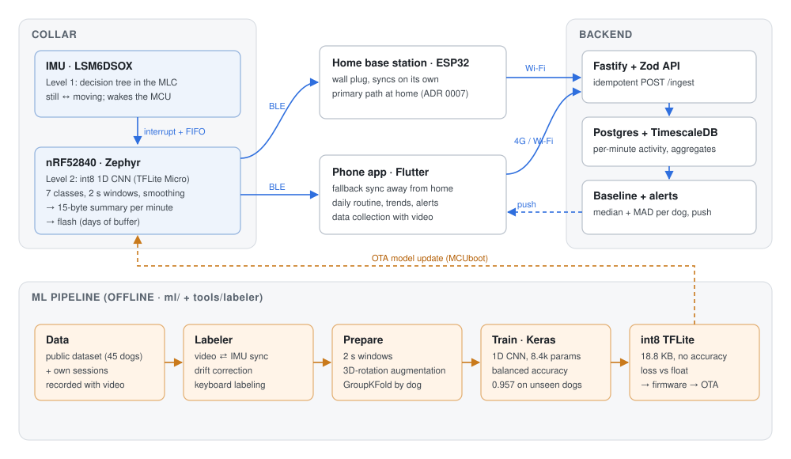
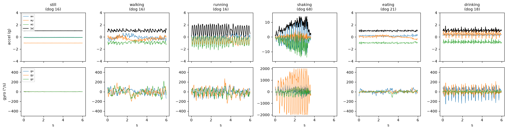
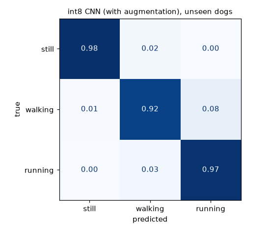
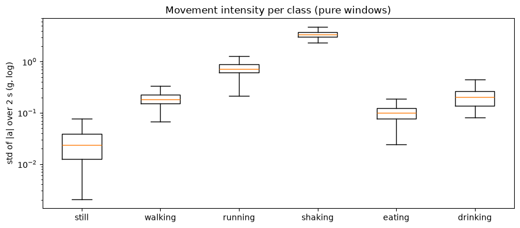

# Smart Dog Collar · on-device behavior recognition

A dog collar that **recognizes what the dog is doing on the chip itself** (still, walking,
running, scratching, shaking, and later eating and drinking), learns what is normal for
*that* dog, and warns the owner when something changes: *"scratched 3× more than usual"*,
*"restless night"*, *"activity 40% below normal for 3 days"*.

Built as a product, not a demo: every decision is measured, written down as an
[ADR](docs/decisions/), and every phase ends with an objective done criterion.



> **Status:** Phase 0 (ML pipeline) ✅ complete · Phase 1 (own data collection) in
> progress, hardware on the way. See the [plan](#roadmap).

---

## Highlights

- **TinyML on a coin-sized board.** An int8 1D CNN of **18.8 KB** classifies 2-second IMU
  windows on an nRF52840, with **0.957 balanced accuracy on dogs it has never seen**.
- **Two-level classification for battery life.** A 29-node decision tree runs *inside the
  IMU* (ST's Machine Learning Core) and only wakes the MCU when the dog moves
  (0.986 balanced accuracy for still × moving).
- **Honest evaluation.** Train/test splits are always **by dog** (`GroupKFold`); random
  window splits are forbidden because they inflate accuracy. The code asserts there is no
  leakage.
- **Robust to a rotating collar.** 3D-rotation augmentation keeps accuracy at 0.957 when
  the collar is turned on the neck; without it, accuracy drops to 0.779.
- **Data arrives on its own.** A home base station (ESP32, Wi-Fi) syncs with the collar
  over BLE; the phone app is the fallback away from home. Ingestion is idempotent, so
  nothing is lost or duplicated ([ADR 0007](docs/decisions/0007-data-sync-architecture.md)).
- **Our own labeling tool.** A no-install web app that syncs video and IMU, corrects clock
  drift, and labels with the keyboard ([tools/labeler](tools/labeler/)).

---

## Results so far (Phase 0, public dataset, collar sensor only)

Evaluated with 5-fold `GroupKFold` by dog on the
[Movement Sensor Dataset for Dog Behavior Classification](docs/public-dataset.md)
(45 dogs). Full tables in [docs/results.md](docs/results.md).

| Model | Classes | Balanced accuracy | Size |
|---|---|---:|---:|
| Shallow Random Forest (baseline) | still · walking · running | 0.956 ± 0.013 | ~64 KB |
| **1D CNN, int8** | still · walking · running | **0.957 ± 0.010** | **18.8 KB** |
| 1D CNN, int8, collar rotated | still · walking · running | 0.957 ± 0.010 | 18.8 KB |
| MLC decision tree (in the IMU) | still × moving | 0.986 ± 0.004 | 29 nodes |

<table>
  <tr>
    <td width="58%"></td>
    <td width="42%"></td>
  </tr>
  <tr>
    <td><sub>How each behavior looks from the collar: still is flat, walking and running
    are periodic, shaking is a short burst that saturates the gyroscope.</sub></td>
    <td><sub>int8 CNN on unseen dogs. The remaining confusion is fast walking × slow trot.</sub></td>
  </tr>
</table>



<sub>A single feature (variation of the acceleration magnitude over 2 s) already grows
~10× per step from still to walking to running to shaking.</sub>

> These numbers come from a public dataset (different sensor, controlled environment).
> The drop on our own dog's data (domain gap) will be measured in Phase 1.

---

## What the owner sees

The app is built around questions an owner actually asks, always compared against the
dog's own normal ([docs/product/indicators.md](docs/product/indicators.md)):

| Indicator | Question |
|---|---|
| **Exercise** | Did he burn his energy today? |
| **Sleep** | Did he sleep well? How often did he wake up? |
| **Skin** | Is he scratching more than usual? |
| **Something's off** | Is he lethargic or acting differently? |
| **Water** *(Phase 6)* | Is he drinking a lot more? |

Experimental: **sleeping respiratory rate** from the accelerometer while the dog is still.
Vets ask owners to count resting breaths because a persistent increase is an early sign of
heart disease.

---

## How it works

**On the collar.** The IMU samples at 50 Hz (±16 g, ±2000 dps). A tiny decision tree in
the IMU decides still × moving; while the dog is still, the MCU sleeps and just counts
time. When the dog moves, the MCU runs the CNN on 2 s windows (7 channels: 3-axis accel,
3-axis gyro, and acceleration magnitude), smooths the output (majority vote for states,
event detection for short bursts like shakes), and writes a **15-byte summary per minute**
to flash, enough for weeks of history.

**Getting data out.** A home base station (or the phone) asks the collar for "everything
since minute X" over BLE and uploads it over Wi-Fi. The backend keys every minute by
`device_id + minute_ts`, so re-sending a batch is harmless.

**In the backend.** TimescaleDB stores per-minute activity; a nightly job builds each dog's
baseline (median + MAD per hour of day, weekday vs weekend, last 28 days) and raises alerts
with a robust z-score only after 14 days of history.

The data formats (classes, packets, CSVs, summary record) are fixed
[contracts](CLAUDE.md#4-contracts-do-not-change-without-an-adr); changing one requires an ADR.

---

## Repository layout

```
ml/              Python: dataset loader, windows, features, CNN, int8 export, tests
  notebooks/     exploration (01_explore.ipynb)
  scripts/       download data, train baseline/CNN, generate a synthetic session
tools/labeler/   web labeling tool (video + IMU), no build step
firmware/        Zephyr / nRF Connect SDK (Phase 1+)
basestation/     ESP32 home base station (Phase 4)
app/             Flutter app (Phase 1+)
backend/         Fastify + TimescaleDB (Phase 4)
hardware/        enclosure CAD and custom PCB (Phase 6)
docs/            ADRs, results, dataset notes, product indicators
```

---

## Getting started

### ML pipeline

Requires [uv](https://docs.astral.sh/uv/); it installs Python 3.12 for the project.

```bash
cd ml
uv sync                                     # environment + dependencies
uv run python scripts/download_public.py    # public dataset (~440 MB, SHA-256 checked)
uv run python scripts/train_baseline.py     # Random Forest + MLC tree  (~20 s)
uv run python scripts/train_cnn.py          # CNN float + int8, 5 folds (~10 min, CPU)
uv run pytest                               # tests
```

Reports are written to `docs/results/`; the int8 model to `ml/models/` (not versioned).

### Labeling tool

Open `tools/labeler/index.html` in Chrome or Edge. To try it without hardware:

```bash
cd ml && uv run python scripts/make_synthetic_session.py
```

then open the folder `ml/data/raw/synthetic_demo/` in the labeler. The synthetic session
uses real signal, shows the behavior on screen, and simulates clock drift and packet loss.

---

## Engineering decisions

| ADR | Decision |
|---|---|
| [0001](docs/decisions/0001-summary-record-version-byte.md) | Version byte in the per-minute summary |
| [0002](docs/decisions/0002-per-class-smoothing-short-events.md) | Per-class smoothing so short events (shakes) survive |
| [0003](docs/decisions/0003-session-time-sync.md) | Video × IMU sync with start/end taps and drift correction |
| [0004](docs/decisions/0004-stationary-sniffing.md) | Stationary sniffing counts as "still" |
| [0005](docs/decisions/0005-accelerometer-16g.md) | Accelerometer at ±16 g (35% of shakes exceed 8 g) |
| [0006](docs/decisions/0006-keras-for-the-cnn.md) | Keras/TensorFlow for a reliable int8 TFLite path |
| [0007](docs/decisions/0007-data-sync-architecture.md) | Home Wi-Fi base station + phone over BLE (Wi-Fi on the collar kept as an option) |
| [0008](docs/decisions/0008-english-class-names.md) | English class names, stable IDs |

---

## Roadmap

| Phase | Goal | Done when | Status |
|---|---|---|---|
| 0 | ML pipeline on a public dataset | int8 CNN ≥ 85% balanced acc. on unseen dogs, < 64 KB | ✅ 0.957, 18.8 KB |
| 1 | Collect and label data from our own dog | ≥ 2 h labeled, ≥ 3 min per class, < 1% packet loss | 🚧 labeler done, hardware shipping |
| 2 | Model running on the chip | F1 ≥ 0.85 (states), ≥ 0.70 (events), inference < 50 ms | |
| 3 | Wireless, full day on battery, OTA | 24 h recorded, lossless sync, OTA tested | |
| 4 | Backend, alerts, home base station | a real alert fires; no duplicates; data arrives on its own | |
| 5 | Two-level classification for battery life | ≥ 14 days measured in the field | |
| 6 | Sealed product, custom PCB | 1 month of daily use without intervention | |

The detailed checklist lives in [CLAUDE.md](CLAUDE.md#7-plan-by-phase).

## Hardware (prototype)

Seeed XIAO nRF52840 Sense · 3.7 V ~250 mAh LiPo · Raspberry Pi Pico as SWD probe ·
Nordic PPK2 for power measurements · later an LSM6DSOX/LSM6DSV16X (MLC), a MAX17048 fuel
gauge and an ESP32 base station.

## Animal welfare

The dog's comfort comes first: gradual adaptation, minimal weight (the target is well under
3% of body weight; the prototype is ~15 g), regular skin checks, supervised use until the
enclosure is sealed, and no behavior is ever forced to collect data.

## Data and citation

The public dataset is by Vehkaoja et al. (2022), *Data in Brief* 40, 107822, and
Kumpulainen et al. (2021), *Applied Animal Behaviour Science* 241, 105393
([Mendeley Data](https://data.mendeley.com/datasets/vxhx934tbn)). It is downloaded by a
script and never committed.

## License

No license has been chosen yet; all rights reserved until one is added.
