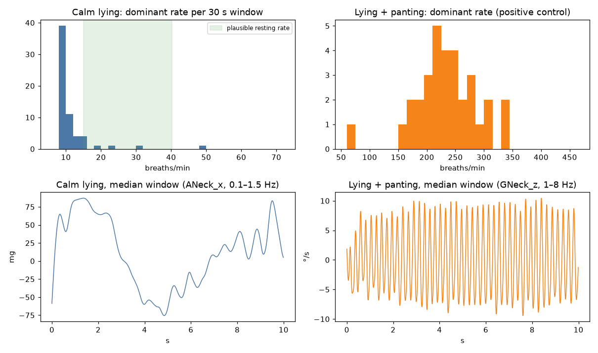

# Breathing feasibility on the public dataset

> Generated by `ml/scripts/breathing_feasibility.py`. Do not edit by hand.

Question: can a neck-mounted IMU see breathing? The public dataset has no breathing ground
truth, so this only checks whether a **plausible, periodic** signal exists. Raw 100 Hz
collar signal, 30 s windows, all 6 channels (the strongest one is used per window).

## Positive control: lying down + panting

- 32 windows from 13 dogs.
- Dominant rate (10th / 50th / 90th percentile): **179, 238, 299 per min**
  (canine panting is typically a few hundred per minute).
- Peak SNR median: **708**.
- **Verdict: the collar clearly sees panting.** Strong, fast respiratory movement produces
  a sharp spectral peak.

## Calm breathing: lying down, not panting

- 62 windows from 18 dogs (median movement std of |a|:
  9.9 mg).
- Dominant rate (10th / 50th / 90th percentile): 8, 9, 14 per min.
- Peak stronger than all 5 matched red-noise surrogates: **68%**
  of windows.
- Peak inside the plausible resting range (15–40/min): **6%**; stuck at the
  lower band edge: **50%** (a sign of slow drift, not breathing).
- Plausible **and** beating the surrogates: **6%**.
- Median change of the dominant rate between consecutive windows of the same lying
  stretch: 1.5 per min (n = 33).

**Verdict: inconclusive, leaning negative.** 68% of windows contain a peak
stronger than matched red noise, but it sits at 9/min with
50% of them pinned to the lower edge of the band, which is what slow drift
shaped by the band-pass filter looks like. Only 6% fall in the plausible
resting range. It could also be very slow breathing in deeply resting dogs, which this
dataset cannot confirm without ground truth.

## What this means for the project

- **Panting detection is feasible now** and is useful on its own (heat stress, pain,
  anxiety). The dataset has 296 min of `Panting` labels, so it could become a new class
  (new ID + ADR), probably as an event/flag inside `still`.
- **Resting respiratory rate stays experimental.** This dataset is a weak test: the
  ActiGraph is not our sensor, mounting tightness is unknown, and "lying chest" includes
  awake dogs adjusting posture. The real test is Phase 1 night recordings, counting breaths
  on video. Things to try then: a snug collar, the gyroscope, a more sensitive
  accelerometer range during sleep sampling (e.g. ±2 g, reconfigured at runtime), longer
  windows, and only deep-stillness stretches.
