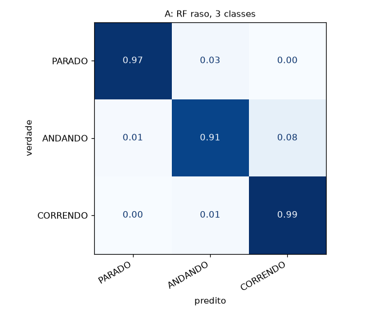
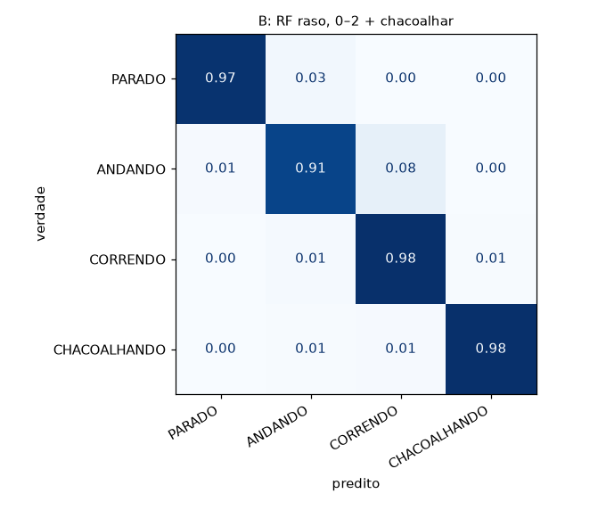
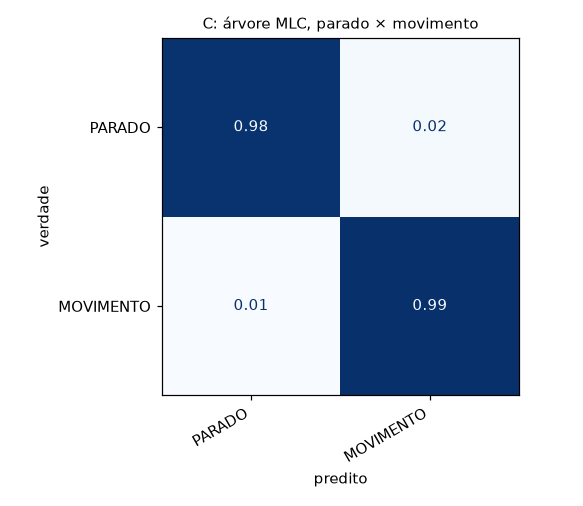

# Fase 0: baseline com features + árvores (dataset público, só coleira)

> Gerado por `ml/scripts/train_baseline.py`. Não editar à mão.

Avaliação: **GroupKFold (5 folds) por cachorro**, ou seja, cada fold testa em cachorros que o modelo nunca viu (regra 2). Janelas de 2 s com passo de 1 s (contrato 4.3), rótulo pela regra do ADR 0002; janelas sem rótulo claro são descartadas. Dados saturados em ±16 g / ±2000 dps (ADR 0005). Matrizes de confusão normalizadas por linha.

## A: Random Forest raso, classes 0–2 (meta da Fase 0)

50 árvores, profundidade ≤ 8, class_weight=balanced. Features: média, desvio, mín, máx, energia e frequência dominante × 7 canais.

- Janelas por classe: {'PARADO': 28233, 'ANDANDO': 7012, 'CORRENDO': 7661}
- **Acurácia balanceada (GroupKFold 5×, por cachorro): 0.956 ± 0.013**
- Por fold: 0.968, 0.959, 0.949, 0.969, 0.934
- Tamanho: 6512 nós ≈ **63.6 KB** (estimativa, ~10 B/nó)
- RAM de inferência: ≈ 1.7 KB (estimativa: janela + features)

| Classe | F1 |
|---|---:|
| PARADO | 0.986 |
| ANDANDO | 0.897 |
| CORRENDO | 0.956 |

## B: Random Forest raso, classes 0–2 + chacoalhar (informativo)

Mesmo modelo de A. Chacoalhar tem pouquíssimas janelas no dataset público.

- Janelas por classe: {'PARADO': 28233, 'ANDANDO': 7012, 'CORRENDO': 7661, 'CHACOALHANDO': 390}
- **Acurácia balanceada (GroupKFold 5×, por cachorro): 0.960 ± 0.013**
- Por fold: 0.969, 0.975, 0.952, 0.966, 0.939
- Tamanho: 5294 nós ≈ **51.7 KB** (estimativa, ~10 B/nó)
- RAM de inferência: ≈ 1.7 KB (estimativa: janela + features)

| Classe | F1 |
|---|---:|
| PARADO | 0.985 |
| ANDANDO | 0.893 |
| CORRENDO | 0.953 |
| CHACOALHANDO | 0.931 |

## C: Árvore única compatível com MLC: parado × movimento (nível 1, Fase 5)

Profundidade ≤ 4. Features só do tipo que o MLC calcula (média, variância, energia, pico a pico, mín, máx); sem FFT. Movimento = andando + correndo + chacoalhando.

- Janelas por classe: {'PARADO': 28233, 'MOVIMENTO': 15063}
- **Acurácia balanceada (GroupKFold 5×, por cachorro): 0.986 ± 0.004**
- Por fold: 0.981, 0.990, 0.986, 0.990, 0.981
- Tamanho: 29 nós ≈ **0.3 KB** (estimativa, ~10 B/nó)
- RAM de inferência: ≈ 1.7 KB (estimativa: janela + features)

| Classe | F1 |
|---|---:|
| PARADO | 0.987 |
| MOVIMENTO | 0.977 |

Features usadas pela árvore C: acc_mag_energy, acc_mag_mean, acc_mag_p2p, acc_mag_var, ax_var, ay_energy, ay_max, ay_min, az_max, gz_var
