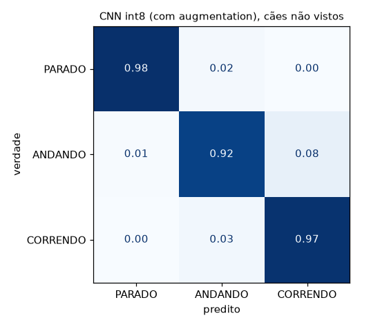

# Fase 0: CNN 1D (float × int8), dataset público, só coleira

> Gerado por `ml/scripts/train_cnn.py`. Não editar à mão.

Arquitetura: 3× [Conv1D k=5 → ReLU → MaxPool 2] (16/32/32) → GAP → Dense softmax. 8419 parâmetros. Treino: 25 épocas, Adam com cosine decay, class_weight balanceado. Avaliação: **GroupKFold 5× por cachorro**. Quantização: int8 completa (pesos, ativações, entrada e saída), calibrada só com janelas de treino de cada fold.

- `aug`: rotação 3D uniforme + escala ±10% + ruído, sorteados de novo a cada época
- `noaug`: sem augmentation
- teste *rotacionado*: as mesmas janelas de teste com uma rotação 3D aleatória fixa por janela (simula a coleira girada ou montada diferente)

## Acurácia balanceada (média ± desvio entre folds)

| Variante | Teste | float | int8 |
|---|---|---:|---:|
| aug | original | 0.957 ± 0.010 | 0.957 ± 0.010 |
| aug | rotacionado | 0.958 ± 0.010 | 0.957 ± 0.010 |
| noaug | original | 0.966 ± 0.010 | 0.965 ± 0.010 |
| noaug | rotacionado | 0.778 ± 0.033 | 0.779 ± 0.032 |

## Modelo oficial: `aug`, int8, teste original

- **Acurácia balanceada: 0.957 ± 0.010**
- Tamanho do `.tflite` int8 (modelo final): **18.8 KB**
- RAM de ativações (estimativa, int8): ~2.3 KB. O arena real do TFLM inclui overhead e será medido na Fase 2

| Classe | F1 |
|---|---:|
| PARADO | 0.991 |
| ANDANDO | 0.911 |
| CORRENDO | 0.951 |

