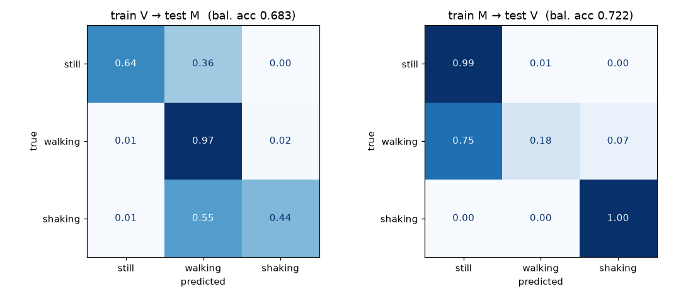

# Two public datasets: generalization and more data

> Generated by `ml/scripts/train_multi.py`. Do not edit by hand.

- **V**: Vehkaoja et al. 2022, 45 dogs of many breeds, collar, indoor arena.
- **M**: Marcato et al. 2023, 42 assistance dogs (Labrador/Golden), neck strap.

Both: neck IMU at 50 Hz, ±16 g / ±2000 dps, 2 s windows, the same 1D CNN as Phase 0
(2 epochs, 3D-rotation augmentation), float model. Balanced accuracy is computed over
the classes present in each test set.

## Experiment 1: train on one dataset, test on the other

Classes both datasets have: still, walking, shaking. Nothing about the test population is
seen during training (different dogs, mounting, lab and annotators).

| Train | Test | Balanced acc. | F1 |
|---|---|---:|---|
| V (45 dogs) | M | 0.683 | still 0.78 · walking 0.66 · shaking 0.36 |
| M (42 dogs) | V | 0.722 | still 0.91 · walking 0.29 · shaking 0.60 |

## Experiment 2: does adding the second dataset help?

GroupKFold (5 folds) by dog over V ∪ M, classes still / walking / running / shaking. In
each fold both variants are tested on the same unseen dogs.

| Test dogs | Trained on | Balanced acc. | F1 |
|---|---|---:|---|
| V test dogs | V only | 0.946 | still 0.98 · walking 0.87 · running 0.92 · shaking 0.82 |
| V test dogs | V + M | 0.957 | still 0.99 · walking 0.90 · running 0.94 · shaking 0.88 |
| M test dogs | V only | 0.632 | still 0.81 · walking 0.62 · shaking 0.47 |
| M test dogs | V + M | 0.677 | still 0.85 · walking 0.69 · shaking 0.47 |

Combined model (all 87 dogs), int8: **18.8 KB**, saved to
`ml/models/cnn_multi_int8.tflite` (not versioned).
