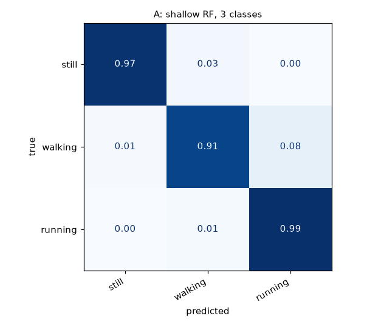
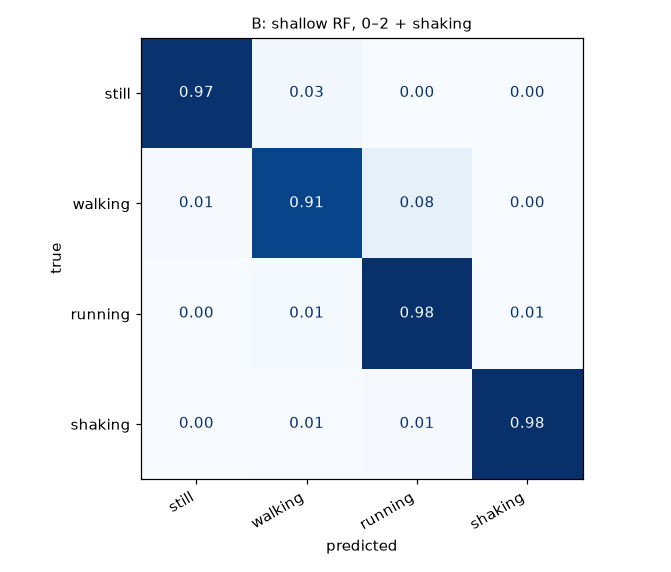
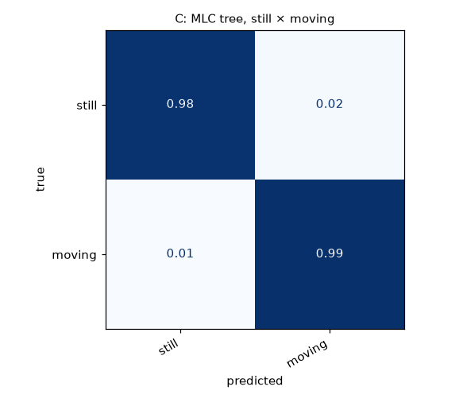

# Phase 0: features + trees baseline (public dataset, collar only)

> Generated by `ml/scripts/train_baseline.py`. Do not edit by hand.

Evaluation: **GroupKFold (5 folds) by dog**: every fold is tested on dogs the model has never seen (rule 2). 2 s windows with a 1 s step (contract 4.3), labeled with the ADR 0002 rule; windows without a clear label are dropped. Data saturated at ±16 g / ±2000 dps (ADR 0005). Confusion matrices are row-normalized.

## A: Shallow Random Forest, classes 0–2 (Phase 0 target)

50 trees, depth ≤ 8, class_weight=balanced. Features: mean, std, min, max, energy and dominant frequency × 7 channels.

- Windows per class: {'still': 28233, 'walking': 7012, 'running': 7661}
- **Balanced accuracy (GroupKFold 5×, by dog): 0.956 ± 0.013**
- Per fold: 0.968, 0.959, 0.949, 0.969, 0.934
- Size: 6512 nodes ≈ **63.6 KB** (estimate, ~10 B/node)
- Inference RAM: ≈ 1.7 KB (estimate: window + features)

| Class | F1 |
|---|---:|
| still | 0.986 |
| walking | 0.897 |
| running | 0.956 |

## B: Shallow Random Forest, classes 0–2 + shaking (informative)

Same model as A. Shaking has very few windows in the public dataset.

- Windows per class: {'still': 28233, 'walking': 7012, 'running': 7661, 'shaking': 390}
- **Balanced accuracy (GroupKFold 5×, by dog): 0.960 ± 0.013**
- Per fold: 0.969, 0.975, 0.952, 0.966, 0.939
- Size: 5294 nodes ≈ **51.7 KB** (estimate, ~10 B/node)
- Inference RAM: ≈ 1.7 KB (estimate: window + features)

| Class | F1 |
|---|---:|
| still | 0.985 |
| walking | 0.893 |
| running | 0.953 |
| shaking | 0.931 |

## C: Single MLC-compatible tree: still × moving (level 1, Phase 5)

Depth ≤ 4. Only feature types the MLC computes (mean, variance, energy, peak-to-peak, min, max); no FFT. Moving = walking + running + shaking.

- Windows per class: {'still': 28233, 'moving': 15063}
- **Balanced accuracy (GroupKFold 5×, by dog): 0.986 ± 0.004**
- Per fold: 0.981, 0.990, 0.986, 0.990, 0.981
- Size: 29 nodes ≈ **0.3 KB** (estimate, ~10 B/node)
- Inference RAM: ≈ 1.7 KB (estimate: window + features)

| Class | F1 |
|---|---:|
| still | 0.987 |
| moving | 0.977 |

Features used by tree C: acc_mag_energy, acc_mag_mean, acc_mag_p2p, acc_mag_var, ax_var, ay_energy, ay_max, ay_min, az_max, gz_var
