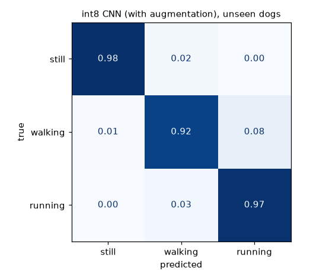

# Phase 0: 1D CNN (float × int8), public dataset, collar only

> Generated by `ml/scripts/train_cnn.py`. Do not edit by hand.

Architecture: 3× [Conv1D k=5 → ReLU → MaxPool 2] (16/32/32) → GAP → Dense softmax. 8419 parameters. Training: 25 epochs, Adam with cosine decay, balanced class weights. Evaluation: **GroupKFold 5× by dog**. Quantization: full int8 (weights, activations, input and output), calibrated only on each fold's training windows.

- `aug`: uniform 3D rotation + ±10% scale + noise, re-drawn every epoch
- `noaug`: no augmentation
- *rotated* test: the same test windows with a fixed random 3D rotation per window (simulates a collar turned on the neck or mounted differently)

## Balanced accuracy (mean ± std across folds)

| Variant | Test | float | int8 |
|---|---|---:|---:|
| aug | original | 0.957 ± 0.010 | 0.957 ± 0.010 |
| aug | rotated | 0.958 ± 0.010 | 0.957 ± 0.010 |
| noaug | original | 0.966 ± 0.010 | 0.965 ± 0.010 |
| noaug | rotated | 0.778 ± 0.033 | 0.779 ± 0.032 |

## Official model: `aug`, int8, original test

- **Balanced accuracy: 0.957 ± 0.010**
- int8 `.tflite` size (final model): **18.8 KB**
- Activation RAM (estimate, int8): ~2.3 KB. The real TFLM arena includes overhead and will be measured in Phase 2

| Class | F1 |
|---|---:|
| still | 0.991 |
| walking | 0.911 |
| running | 0.951 |

