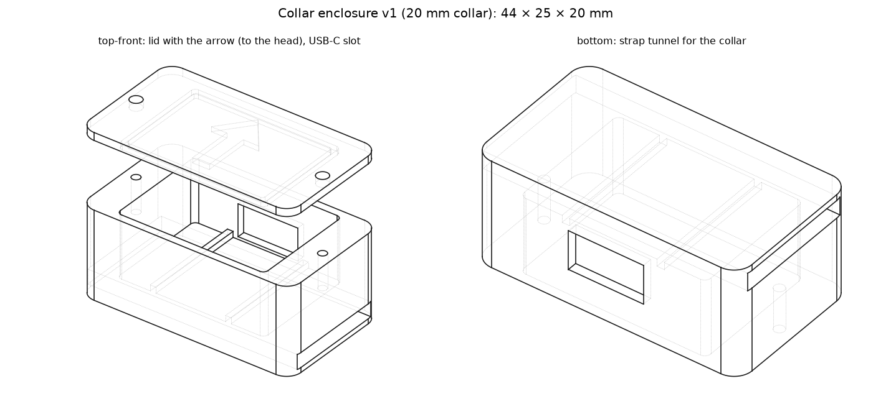

# Collar enclosure (prototype v1)

Parametric CAD in Python ([build123d](https://github.com/gumyr/build123d)): the source is
`enclosure.py`, and `out/` has the exported **STEP** (for editing in any CAD) and **STL** (for
printing) of this version.



| | |
|---|---|
| Size | 44 × 25 × 20 mm (29 mm wide for 25 mm collars) |
| Weight | shell ≈ 10 g; with XIAO + 502030 LiPo ≈ 19–22 g → < 3% of body weight for dogs ≥ 0.7 kg |
| Inside | XIAO nRF52840 Sense at the bottom (components up, USB-C to the side slot), 502030 LiPo on top on foam tape |
| Collar | strap tunnel under the floor; three variants: collars up to **16, 20 or 25 mm** wide and 2.6 mm thick |
| Closing | 2 × M2 × 6 mm self-tapping screws (flat or pan head) in the end ears |
| Orientation | arrow on the lid: points to the dog's head (contract 4.2, always the same way) |
| Water | **not** waterproof: supervised use, no baths or swimming (sealed TPU version: Phase 6) |

## Files

| File | Print |
|---|---|
| `out/base_strap16mm.stl` / `20mm` / `25mm` | pick by collar width; open side up, **no supports** (the tunnel roof prints as a 16–25 mm bridge) |
| `out/lid.stl` | outer face on the bed (already oriented); the 25 mm base has its own `lid_strap25mm.stl` |
| `out/enclosure_v1_strap20mm.step` | assembly for editing in other CAD tools |

PETG, 0.2 mm layers, 4 perimeters (the 1.6 mm walls end up solid), 25% infill, no supports.
TPU works too for a softer, bite-tolerant shell (print slower). Do not use PLA on a dog: it
softens in a hot car or in the sun.

## Changing it

```bash
cd hardware/cad
uv run python enclosure.py                              # STEP + STL + fit check + weight
uv run --with matplotlib python render_preview.py       # updates docs/images/enclosure_v1.png
```

Everything is in `Params` at the top of `enclosure.py`: part sizes, collar width/thickness,
walls, lid fit, screws. **Measure your own battery and board** (calipers) and change the
numbers if they differ. A different cell, e.g. 402030 (200 mAh, 4 mm), makes the case lower.
The script refuses to export if the board, battery, collar strap or USB-C plug would collide
with the shell (`check_fit`). That check already caught one problem: the USB slot did not go
all the way through the thicker wall of the 25 mm variant.

Every printed version that goes on a dog gets a new `vN` and its STEP + STL in `out/`.
